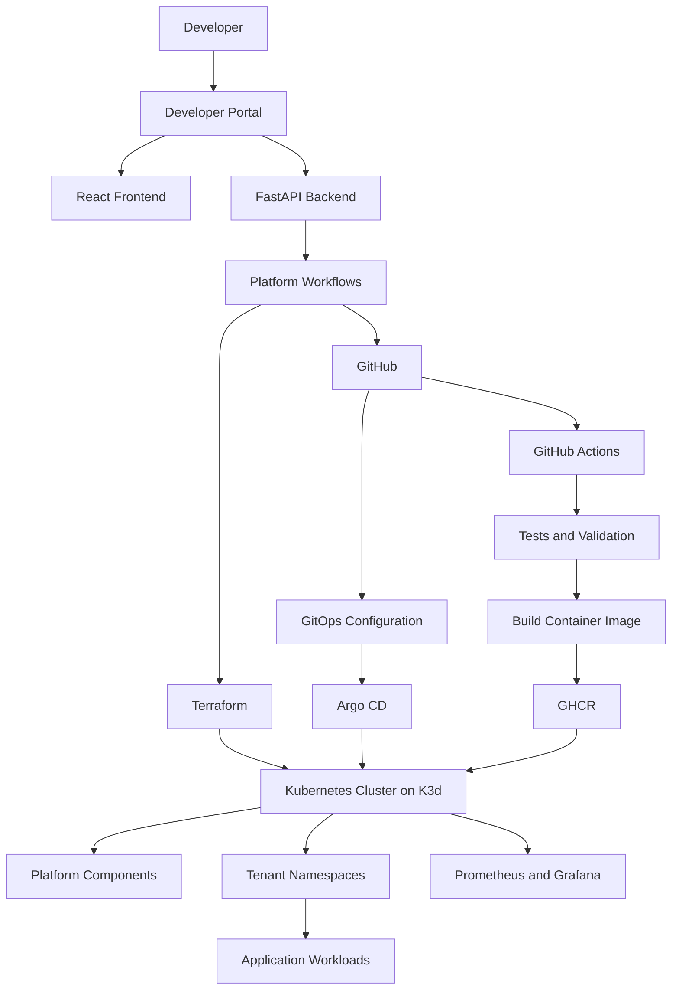

# Internal Developer Platform

A hands-on Internal Developer Platform (IDP) built to explore Kubernetes, Infrastructure as Code, GitOps, CI/CD, multi-tenancy, and platform engineering.

> **Project status:** Planning / Phase 1 — Foundation  
> **Initial operating model:** Local-first, zero-cost-first development using Docker Desktop and K3d.

## Overview

DevPlatform aims to give application developers a self-service way to create services, request environments, deploy workloads, and inspect their operational status without having to manage every underlying Kubernetes resource manually.

The project is intentionally built incrementally. It starts with a local Kubernetes environment and a sample application, then adds Terraform-managed platform foundations, CI, GitOps, tenant provisioning, a developer portal, and observability.

The objective is not simply to deploy an application to Kubernetes. It is to understand how infrastructure, automation, orchestration, GitOps, and developer experience fit together to form an Internal Developer Platform.

## Goals

- Build and operate a local multi-node Kubernetes environment.
- Develop a deeper understanding of Kubernetes networking, scheduling, storage, security, and workload management.
- Use Terraform to manage foundational infrastructure and Kubernetes resources declaratively.
- Build reusable Terraform modules.
- Package workloads with Helm.
- Build CI workflows with GitHub Actions.
- Build and publish container images to GitHub Container Registry (GHCR).
- Use Argo CD to implement GitOps-based application delivery.
- Implement tenant isolation using namespaces, RBAC, quotas, and network policies.
- Build a self-service developer portal.
- Add metrics, dashboards, logs, and alerts.
- Explore AI-assisted platform operations as a later extension.

## Architecture at a glance



## Technology stack

| Area | Technology | Purpose |
|---|---|---|
| Containerization | Docker | Build and run container images |
| Local cluster lifecycle | K3d | Create and remove the local Kubernetes cluster |
| Orchestration | Kubernetes | Schedule and operate workloads |
| Infrastructure as Code | Terraform | Manage selected foundational resources |
| Application packaging | Helm | Package and configure Kubernetes applications |
| GitOps | Argo CD | Reconcile cluster state from Git |
| CI | GitHub Actions | Test code and build/publish images |
| Container registry | GHCR | Store application images |
| Backend | Python, FastAPI | Expose platform APIs and workflows |
| Frontend | React | Provide the developer-facing interface |
| Database | PostgreSQL | Store platform/application data where needed |
| Observability | Prometheus, Grafana | Metrics, dashboards, and alerts |
| Version control | Git, GitHub | Source code and desired-state storage |

The initial environment is designed to run locally. A paid cloud account is not required for the core learning path.

## Component responsibilities and ownership

Clear ownership is important to avoid multiple tools continuously changing the same resources.

| Component | Owns / is responsible for | Does not own |
|---|---|---|
| K3d | Local Kubernetes cluster lifecycle | Tenant resources or application releases |
| Terraform | Explicitly selected foundational resources, such as tenant namespaces, quotas, and RBAC | K3d cluster lifecycle or resources owned by Argo CD |
| Kubernetes | Scheduling, networking, storage, and workload runtime | Source-of-truth configuration outside the cluster |
| Helm | Reusable application chart templates and values | Cluster lifecycle |
| GitHub Actions | CI checks, tests, image builds, and publishing | Ongoing deployment reconciliation |
| GHCR | Container image storage | Deployment configuration |
| Argo CD | GitOps-managed application and platform releases | Terraform-managed foundational resources |
| FastAPI | Platform API and orchestration logic | Direct, untracked changes to cluster state |
| React | Developer-facing user interface | Infrastructure provisioning logic |

**Ownership rule:** A Kubernetes resource should have one declared lifecycle owner. For example, if Terraform creates a tenant namespace and quota, Argo CD should not also manage those same objects.

Terraform's Kubernetes and Helm providers will be configured only after the cluster exists and is reachable. K3d remains the owner of the local cluster lifecycle.

## Repository layout

```text
devplatform/
├── README.md
├── CONTRIBUTING.md
├── .gitignore
├── .editorconfig
├── docs/
│   ├── architecture.md
│   └── decisions/
│       └── 0001-initial-architecture.md
├── infrastructure/
│   ├── k3d/
│   └── terraform/
│       ├── modules/
│       └── environments/
│           └── local/
├── kubernetes/
│   ├── base/
│   ├── platform/
│   └── applications/
├── helm/
├── gitops/
│   ├── bootstrap/
│   ├── applications/
│   └── tenants/
├── services/
│   ├── sample-app/
│   └── platform-api/
├── portal/
│   └── frontend/
├── .github/
│   └── workflows/
└── scripts/
```

Directories will be added as their corresponding phases begin. The layout is the intended destination, not a requirement to create empty folders up front.

## Delivery roadmap

### Phase 1 — Project foundation
- [ ] Create the GitHub repository.
- [ ] Add the initial documentation and project conventions.
- [ ] Establish the repository layout.
- [ ] Verify the local development tools.
- [ ] Record the initial architecture decisions.

### Phase 2 — Local Kubernetes environment
- [ ] Install/configure Docker Desktop and WSL2 integration.
- [ ] Install K3d and kubectl.
- [ ] Create a multi-node cluster from a checked-in configuration file.
- [ ] Configure host access and Kubernetes contexts.
- [ ] Explore nodes, Pods, Deployments, Services, Ingress, ConfigMaps, Secrets, storage, probes, and resource controls.
- [ ] Deploy and troubleshoot sample workloads.

### Phase 3 — Terraform and Infrastructure as Code
- [ ] Learn providers, resources, variables, outputs, state, and dependency management.
- [ ] Configure Terraform to connect to the existing local cluster.
- [ ] Create reusable modules for selected foundational resources.
- [ ] Manage tenant namespaces, quotas, and RBAC.
- [ ] Practice plan/apply/destroy, drift detection, and safe state handling.

### Phase 4 — Sample application
- [ ] Build a Python/FastAPI sample service.
- [ ] Containerize it.
- [ ] Add health and readiness endpoints.
- [ ] Integrate PostgreSQL.
- [ ] Deploy it to Kubernetes and test failure scenarios.

### Phase 5 — Helm
- [ ] Create reusable Helm charts.
- [ ] Add environment-specific values.
- [ ] Deploy, upgrade, inspect, and roll back releases.

### Phase 6 — CI
- [ ] Create GitHub Actions workflows.
- [ ] Run tests and code-quality checks.
- [ ] Build and publish images to GHCR.
- [ ] Use immutable image tags and configure least-privilege workflow permissions.
- [ ] Add image scanning.

### Phase 7 — GitOps
- [ ] Install Argo CD.
- [ ] Connect a Git repository.
- [ ] Deploy applications through Argo CD and Helm.
- [ ] Practice synchronization, pruning, self-healing, and rollback through Git.

### Phase 8 — Multi-tenancy
- [ ] Define the tenant model.
- [ ] Provision namespaces, quotas, RBAC, and network policies.
- [ ] Automate tenant onboarding and cleanup.
- [ ] Deploy tenant applications using Argo CD Applications or ApplicationSets.
- [ ] Test tenant isolation.

### Phase 9 — Developer portal
- [ ] Build the React frontend and FastAPI backend.
- [ ] Implement a service catalog and reusable service templates.
- [ ] Add service and environment request workflows.
- [ ] Display deployment and resource status.
- [ ] Add authentication, authorization, and audit logging.

### Phase 10 — Observability
- [ ] Install Prometheus and Grafana.
- [ ] Create cluster and application dashboards.
- [ ] Collect application logs.
- [ ] Configure useful alerts.

### Phase 11 — Security and reliability
- [ ] Apply least-privilege RBAC.
- [ ] Handle secrets securely.
- [ ] Configure network policies and Pod security controls.
- [ ] Test scaling, failure recovery, and backups.
- [ ] Document operational procedures.

### Phase 12 — Advanced platform capabilities
- [ ] Improve environment provisioning workflows.
- [ ] Explore Terraform module versioning and state separation.
- [ ] Add policy as code.
- [ ] Explore deployment strategies and service mesh concepts.
- [ ] Add resource/cost visibility where practical.

### Phase 13 — Testing
- [ ] Test application code and APIs.
- [ ] Validate Terraform modules and Helm charts.
- [ ] Test GitOps reconciliation and tenant isolation.
- [ ] Add end-to-end platform tests.

### Phase 14 — Documentation and portfolio
- [ ] Document architecture, setup, and operations.
- [ ] Add diagrams and screenshots.
- [ ] Record design trade-offs and troubleshooting notes.
- [ ] Publish a demonstration.

### Phase 15 — Optional AI integration
- [ ] Design an AI assistant for platform operations.
- [ ] Build an MCP server with read-only Kubernetes tools first.
- [ ] Add troubleshooting workflows.
- [ ] Require explicit human approval for write operations.
- [ ] Evaluate accuracy, safety, and auditability.

## Local development prerequisites

The initial target environment is:

- Windows 11 with WSL2
- Docker Desktop with WSL2 integration
- Git
- VS Code
- Python
- Node.js and npm
- K3d
- kubectl
- Terraform
- Helm

Tool installation will be documented as the relevant phase begins. Versions should be pinned or recorded for reproducibility.

## Security and repository hygiene

- Never commit credentials, API tokens, private keys, kubeconfig files, or `.env` files.
- Do not commit Terraform state or plan files.
- Use GitHub Actions secrets and least-privilege workflow permissions.
- Keep local configuration separate from committed examples.
- Treat Terraform state as sensitive, even when the managed resources are local.

## Learning principles

1. Understand each component before automating it.
2. Prefer reproducible, version-controlled configuration.
3. Keep ownership boundaries explicit.
4. Make changes incrementally and validate them.
5. Document why important design decisions were made.
6. Keep the initial platform small enough to run on a local machine.

## Current status

**Planning / Phase 1 — Project foundation.**

The next milestone is to create the repository, add the initial documentation, verify the development environment, and commit the foundation before starting the Kubernetes implementation.