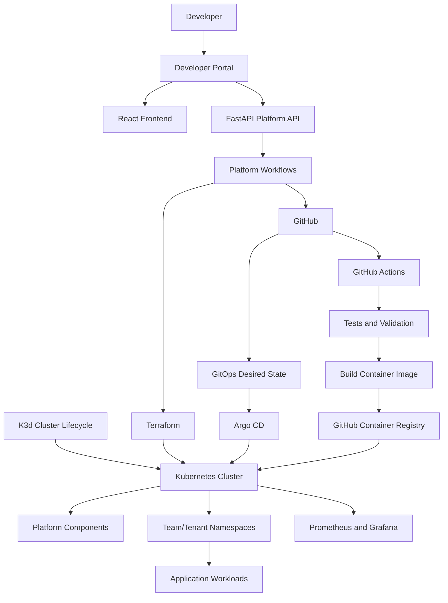

# DevPlatform Architecture

## 1. Purpose

This document describes the target architecture for DevPlatform, a local-first Internal Developer Platform (IDP).

The platform will provide a self-service interface for developers to create services, request environments, deploy workloads, and inspect application status. The implementation is incremental: the local Kubernetes foundation comes first, followed by CI, GitOps, multi-tenancy, the developer portal, and observability.

## 2. Architectural principles

- **Local-first:** the core learning path must not require paid cloud infrastructure.
- **Single ownership:** each resource has one lifecycle owner.
- **Declarative configuration:** infrastructure and application desired state should be version-controlled.
- **GitOps delivery:** Argo CD reconciles application deployments from Git.
- **Least privilege:** automation and workloads receive only the permissions they need.
- **Incremental complexity:** introduce components when there is a concrete use case.
- **Reproducibility:** document versions, configuration, and operational steps.

## 3. Logical architecture



This is a target-state view. Not every integration exists in Phase 1.

## 4. Component responsibilities

### 4.1 K3d

K3d runs lightweight K3s Kubernetes clusters in Docker containers.

Responsibilities:
- Create and delete the local cluster.
- Configure the local cluster topology and exposed ports.
- Make the Kubernetes API reachable from the development host.

K3d owns the lifecycle of the local cluster. Terraform must not also attempt to create or destroy that cluster.

### 4.2 Kubernetes

Kubernetes is the workload orchestration layer.

Topics explored by this project include:
- Control plane and worker-node responsibilities.
- Pods, Deployments, ReplicaSets, and DaemonSets.
- Services, DNS, Ingress, and network policies.
- ConfigMaps and Secrets.
- PersistentVolumes and PersistentVolumeClaims.
- Requests, limits, quotas, and scheduling.
- Probes, rollouts, autoscaling, and recovery.
- Namespaces, service accounts, and RBAC.

### 4.3 Terraform

Terraform manages a defined set of foundational resources after the Kubernetes cluster exists.

Initial intended scope:
- Namespaces.
- ResourceQuotas and LimitRanges.
- Service accounts and RBAC.
- Other explicitly assigned tenant/platform foundations.

Terraform responsibilities:
- Define resources declaratively.
- Reuse modules for repeatable patterns.
- Review changes with `terraform plan`.
- Apply and track changes through Terraform state.
- Detect and reconcile configuration drift.

Terraform does not own K3d cluster lifecycle. Terraform state and plan files must not be committed.

The Kubernetes and Helm providers should be configured only after the cluster is available and the kubeconfig is valid. Provider authentication should use local configuration or an appropriate secret mechanism, not hardcoded credentials.

### 4.4 Helm

Helm packages Kubernetes applications as charts.

Responsibilities:
- Define reusable templates.
- Separate application defaults from environment-specific values.
- Support repeatable install and upgrade operations.

Helm charts describe resources; the chosen deployment controller (eventually Argo CD) owns the release lifecycle for GitOps-managed applications.

### 4.5 GitHub Actions

GitHub Actions provides continuous integration.

Expected workflow:
1. Trigger on pull requests and pushes.
2. Run tests and static checks.
3. Validate relevant Terraform and Helm configuration.
4. Build a container image.
5. Publish the image to GHCR after the required checks pass.
6. Update the deployment configuration or image reference through a controlled Git workflow.

CI should not become a second continuous deployment controller. Once GitOps is established, Argo CD performs ongoing reconciliation.

### 4.6 Argo CD

Argo CD continuously compares the desired state in Git with the live Kubernetes state.

Responsibilities:
- Deploy applications and platform components assigned to GitOps.
- Synchronize Helm charts or Kubernetes manifests.
- Detect drift.
- Support controlled pruning and self-healing.

Argo CD should not manage resources assigned to Terraform, such as Terraform-owned tenant namespaces or quotas.

### 4.7 Developer portal

The portal consists of:
- **React frontend:** user interface and service catalog.
- **FastAPI backend:** API, validation, authorization, and workflow orchestration.

Planned capabilities:
- Browse service templates.
- Request a new service.
- Request a team/environment.
- View deployment and environment status.
- View selected resource information.

The backend should invoke controlled automation workflows rather than making arbitrary, untracked changes to Kubernetes.

### 4.8 Observability

Prometheus and Grafana will provide metrics and dashboards. A logging component may be added after the basic metrics path is working.

Observability should answer:
- Is the cluster healthy?
- Are workloads available?
- Are resources under pressure?
- Are application requests failing?
- Did a deployment introduce a regression?

## 5. Ownership boundaries

| Resource / lifecycle | Owner |
|---|---|
| Local K3d cluster | K3d |
| Tenant namespaces (where Terraform-managed) | Terraform |
| Tenant quotas and LimitRanges | Terraform |
| Tenant RBAC foundations (where Terraform-managed) | Terraform |
| Application Deployments and Services | Argo CD via Helm/manifests |
| Application configuration packaged in a chart | Helm, delivered by Argo CD |
| Container images | GHCR |
| Image build and test workflow | GitHub Actions |
| Portal workflows | FastAPI backend and controlled automation |

A resource must not be managed independently by both Terraform and Argo CD. If ownership changes later, perform an explicit migration rather than allowing both tools to reconcile it.

## 6. Main workflows

### 6.1 Application delivery

1. A developer pushes application code to GitHub.
2. GitHub Actions runs tests and validation.
3. CI builds the container image.
4. CI publishes the image to GHCR using an immutable identifier such as a commit SHA.
5. The desired deployment configuration is updated in Git.
6. Argo CD detects the Git change.
7. Argo CD applies the desired application configuration to Kubernetes.
8. Kubernetes schedules and runs the workload.
9. Prometheus and Grafana expose operational health and metrics.

### 6.2 Tenant provisioning

1. A developer requests a team/environment through the portal.
2. The backend validates the request and authorization.
3. A controlled workflow invokes Terraform.
4. Terraform creates the tenant's foundational resources.
5. The workflow records or creates the tenant's GitOps configuration.
6. Argo CD deploys the tenant's application configuration.
7. The portal displays the resulting environment status.

The exact workflow and approval model will be designed during the multi-tenancy phase.

## 7. Repository organization

```text
devplatform/
├── docs/
│   ├── architecture.md
│   └── decisions/
├── infrastructure/
│   ├── k3d/
│   └── terraform/
│       ├── modules/
│       └── environments/
├── kubernetes/
│   ├── base/
│   ├── platform/
│   └── applications/
├── helm/
├── gitops/
│   ├── bootstrap/
│   ├── applications/
│   └── tenants/
├── services/
│   ├── sample-app/
│   └── platform-api/
├── portal/
│   └── frontend/
├── .github/
│   └── workflows/
└── scripts/
```

Folders will be introduced as implementation begins. Avoid creating placeholder files solely to preserve this diagram.

## 8. Deployment environments

### Local

The first and primary environment:
- Docker Desktop provides the container runtime.
- K3d provides a local multi-node Kubernetes cluster.
- Terraform connects to the running cluster for selected Kubernetes resources.
- GitHub Actions runs CI remotely.
- GHCR stores images.
- Argo CD runs inside the local cluster.

### Future environments

The architecture may later be adapted to a remote Kubernetes cluster. This is not a prerequisite for the initial project and should not introduce cloud costs into the core learning path.

## 9. Security considerations

- Never commit kubeconfig files, credentials, tokens, private keys, or `.env` files.
- Treat Terraform state and plan files as sensitive.
- Use least-privilege GitHub Actions permissions.
- Avoid long-lived credentials where short-lived or scoped credentials are available.
- Start with read-only Kubernetes access for any future AI assistant.
- Require explicit authorization and human approval for destructive platform operations.
- Keep tenant boundaries enforced by Kubernetes RBAC and network policies, not merely by portal UI controls.

## 10. Open design questions

These decisions are intentionally deferred until there is enough implementation context:
- Exact K3d node count and resource allocation.
- Ingress controller choice and local DNS approach.
- Terraform state layout for local and future remote environments.
- Whether the portal uses a job queue for long-running provisioning workflows.
- Authentication provider and identity model.
- Logging stack selection.
- Whether GitOps configuration lives in the same repository or a separate repository.